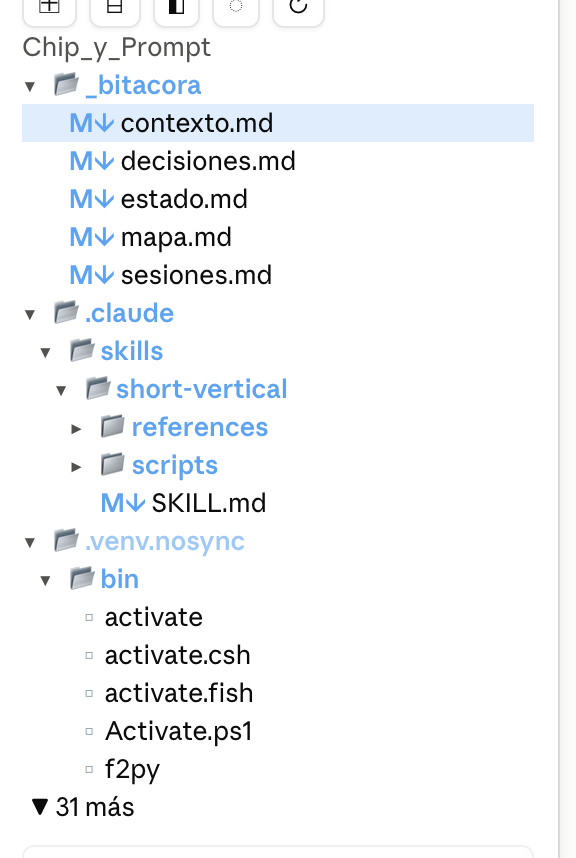

# Explorador

Un panel de **árbol de archivos para Claude Code**, al estilo del explorador de VS Code, que te enseña en todo momento **qué está tocando Claude**:

- 🔵 El archivo que Claude **lee** se ilumina en **azul** con un efecto de respiración.
- 🟠 El archivo que Claude **escribe o edita** se ilumina en **naranja**.
- 📄 Al elegir un archivo, se previsualiza debajo del árbol: **Markdown** formateado y **código** con resaltado.



## Instalación

Necesitas Claude Code con soporte de mods (hooks de funciones).

**Desde la terminal de Claude Code**, en el prompt:

```
/plugin install explorador --marketplace Chamete/explorador
```

Responde `y` para añadir el marketplace y elige el ámbito (el de usuario lo activa en todos tus proyectos).

**Desde una terminal normal:**

```bash
claude plugin install explorador --marketplace Chamete/explorador
```

**En la app de escritorio**, donde `/plugin` no está disponible: pulsa **+** junto a la caja del prompt → **Plugins** → **Add marketplace** con `Chamete/explorador` → **Add plugin**.

Una vez instalado, el panel se abre solo al empezar cada sesión. Si lo cierras, ábrelo con:

```
/explorador
```

## Qué hace

### Árbol del proyecto

- Muestra la carpeta raíz del proyecto de la sesión, aunque Claude cambie de carpeta en la terminal.
- Carpetas primero y en orden alfabético, con 📁 cerrada / 📂 abierta y flecha ▸ / ▾.
- Cada archivo lleva un icono de color según su extensión (`M↓` Markdown, `TS`, `JS`, `{}` JSON, `PY`, `<>` HTML, `♪` audio, `▶` vídeo, `▣` imagen…).
- Clic en una carpeta para desplegarla o plegarla; clic en un archivo para seleccionarlo.
- Por defecto oculta el ruido: `.DS_Store`, `.git`, `node_modules`, `__pycache__`, entornos virtuales y carpetas `*.nosync`.

### Lectura y escritura en directo

- Cuando Claude usa **Read**, la fila del archivo se ilumina en azul y aparece `● leyendo`.
- Cuando usa **Write**, **Edit**, **MultiEdit** o **NotebookEdit**, se ilumina en naranja con `● escribiendo`.
- El efecto dura lo que dura la operación y unos 4 segundos más, para que dé tiempo a verlo.
- Si el archivo está dentro de una carpeta plegada, respira la carpeta.
- Si Claude edita el archivo que estás previsualizando, la vista previa se actualiza sola.

### Vista previa

- **Markdown** (`.md`, `.markdown`, `.mdx`) formateado. Los enlaces a otros `.md` del proyecto se abren en la misma vista previa.
- **Código y texto** (TypeScript, JavaScript, JSON, Python, shell, CSS, HTML, YAML, CSV…) con resaltado de sintaxis y números de línea.
- Archivos de hasta 300 KB; los binarios muestran un aviso.
- Con la vista previa abierta, el árbol ocupa como mucho la mitad del panel, con ▲ / ▼ para moverte.

### Barra de herramientas

| Botón | Qué hace |
|---|---|
| ⌂ | Vuelve a la raíz: pliega todo, borra la búsqueda y sube el panel arriba |
| 🔍 campo *Buscar…* | Filtra el árbol por nombre (sin distinguir mayúsculas ni tildes) |
| ⊞ | Expande todas las carpetas (hasta 400) |
| ⊟ | Pliega todas las carpetas |
| ◧ | Activa o desactiva la vista previa |
| ◌ | Muestra u oculta los archivos ocultos |
| ↻ | Vuelve a leer las carpetas del disco |

Los interruptores (◧ y ◌) salen en color cuando están encendidos. Sus valores se recuerdan entre sesiones.

### Se adapta al panel

- En paneles anchos, la casa, el buscador y los iconos van en una sola fila; en paneles estrechos, los iconos bajan a la siguiente.
- Los nombres largos se recortan con «…» y la sangría se reduce si falta espacio.
- Funciona con tema claro y oscuro.

## Cómo funciona

El mod es un *hooks module* de Claude Code (`hooks/register.tsx`) más un módulo de superficie que dibuja el árbol (`hooks/arbol.tsx`):

1. **Detecta la actividad** con un hook en `tool.call`: antes de que se ejecute una herramienta de archivos marca la ruta como «leyendo» o «escribiendo» y, al terminar, deja que siga respirando 4 segundos. El hook nunca bloquea ni cambia la herramienta: si algo del mod falla, la llamada sigue igual.
2. **Lee las carpetas** con `$.fs.list` solo cuando hace falta (al desplegar, al expandir todo, al buscar o tras una escritura) y guarda lo leído en el estado de la sesión.
3. **Dibuja el panel** con un hook `ui.render` sobre su `Pane`: barra, buscador y vista previa con los elementos de la app.
4. **Dibuja el árbol** en un `Client` (`hooks/arbol.tsx`): un módulo que corre dentro de la app y pinta cada fila con sus colores, resalta la fila bajo el puntero, anima la respiración con su propio reloj (sin redibujar el panel entero) y envía cada clic al mod con `ui.message`.

Más detalle en [docs/como-funciona.md](docs/como-funciona.md).

### Compatibilidad

| Superficie | Árbol | Notas |
|---|---|---|
| App de escritorio | Client con colores, puntero y velo de respiración | Experiencia completa |
| Terminal | Client con colores | La selección se marca en vídeo inverso; sin velo de fondo |
| VS Code y móvil | Filas de botones | Sin colores propios; en el móvil no hay buscador |

### Limitaciones

- Solo detecta lo que Claude hace con sus herramientas de archivos. Si cambia archivos con un comando de shell, no respiran, aunque el árbol se refresca al terminar el comando.
- La vista previa no muestra imágenes ni PDF.
- La API de mods de Claude Code está en acceso anticipado y puede cambiar entre versiones.

## Desarrollo

```
.claude-plugin/plugin.json        manifiesto del mod
.claude-plugin/marketplace.json   este repositorio como marketplace
hooks/hooks.json                  módulo de hooks que carga Claude Code
hooks/register.tsx                lógica: actividad, carpetas, panel y vista previa
hooks/arbol.tsx                   módulo de superficie que dibuja el árbol
types/index.d.ts                  contrato de estado del mod
tests/explorador.test.tsx         pruebas
```

Para trabajar en él, carga la carpeta en una sesión (se recarga sola al guardar):

```bash
claude --plugin-dir .
```

Comprobaciones:

```bash
claude plugin validate .
```

```bash
claude plugin test .
```

## Autor

Hecho por [Chamete](https://github.com/Chamete) con Claude Code.
